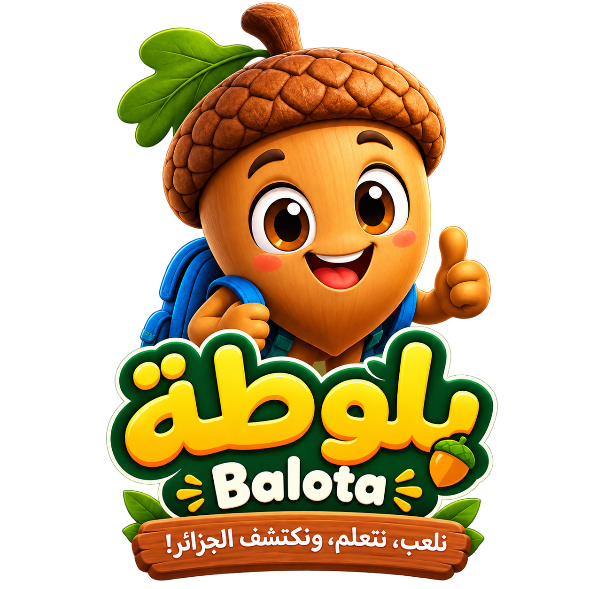
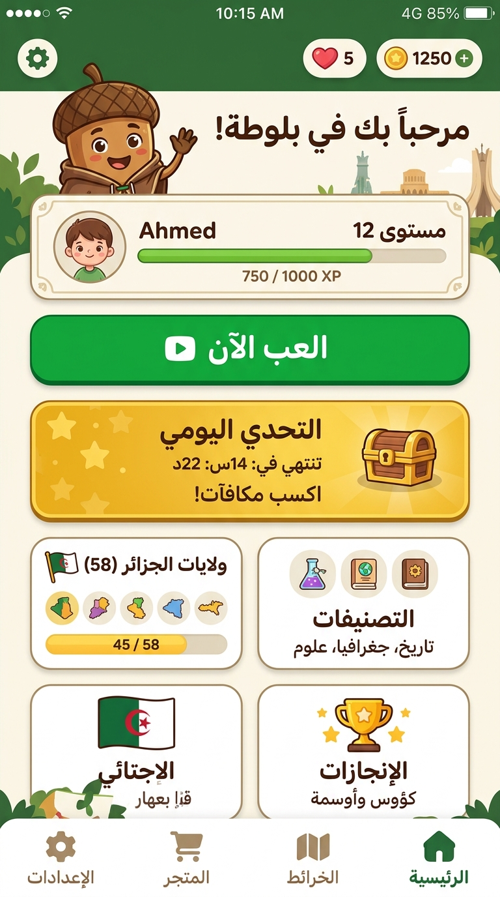
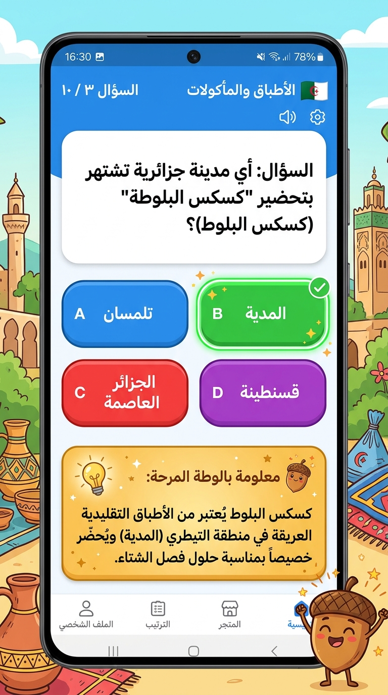
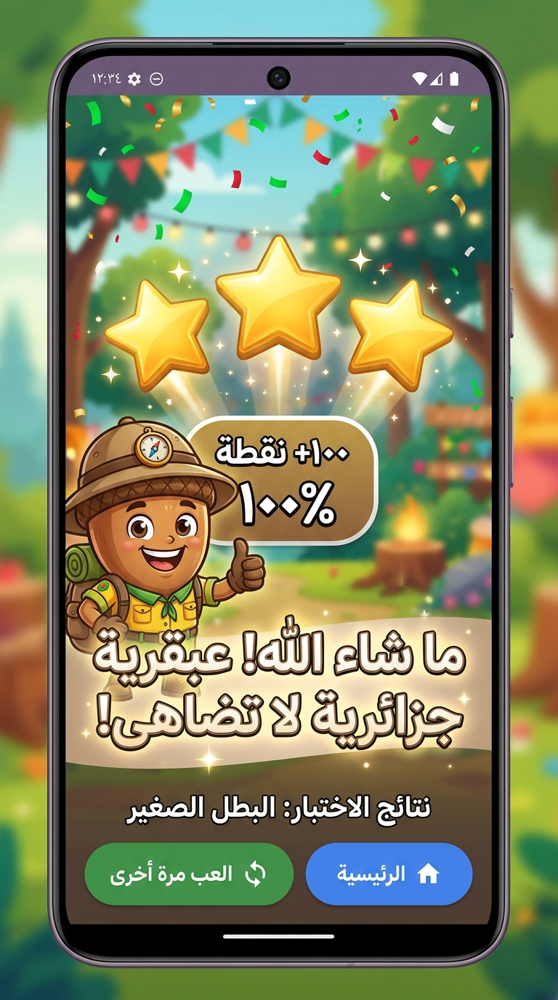

# 🐿️ بلوطة — Balota: Discover Algeria Quiz Game 🇩🇿

<div align="center">
  

  ### **نلعب، نتعلم، ونكتشف الجزائر!**
  *An entertaining and educational Android quiz game for Algerian children.*

  [](https://developer.android.com)
  [](https://kotlinlang.org)
  [](https://developer.android.com/jetpack/compose)
  []()
  []()
</div>

---

## 📑 Table of Contents / جدول المحتويات
- [English Overview](#-english-overview)
  - [Concept & Mascot](#-concept--mascot)
  - [App Screenshots](#-app-screenshots)
  - [Key Features](#-key-features)
  - [Technical Stack & Architecture](#-technical-stack--architecture)
  - [How to Build & Run](#-how-to-build--run)
- [النسخة العربية (Arabic Overview)](#-نبذة-عن-المشروع-باللغة-العربية)
  - [فكرة اللعبة وشخصية بلوطة](#-فكرة-اللعبة-وشخصية-بلوطة)
  - [صور من داخل التطبيق](#-صور-من-داخل-التطبيق)
  - [المميزات الرئيسية](#-المميزات-الرئيسية)
  - [البنية التقنية](#-البنية-التقنية)
  - [طريقة التثبيت والبناء](#-طريقة-التثبيت-والبناء)

---

## 🌟 English Overview

### 💡 Concept & Mascot
**Balota (بلوطة)** is a polished, child-friendly native Android mobile quiz game designed to help children discover Algeria's rich cultural heritage, geography, history, traditional culinary art, clothing, and nature across all **58 wilayas**.

Accompanied by **Balota**, the cheerful and curious acorn explorer mascot, kids embark on fun trivia expeditions filled with interactive questions, uplifting feedback, gold stars, and surprising fun facts about their homeland.

---

### 📸 App Screenshots

<div align="center">
  <table>
    <tr>
      <td align="center">
        <b>🏠 Home Screen</b><br/>
        <i>Mascot Greeting, Daily Challenge & Modes</i><br/><br/>
        
      </td>
      <td align="center">
        <b>🎮 Quiz Gameplay</b><br/>
        <i>Randomized Choices & Fun Fact Card</i><br/><br/>
        
      </td>
      <td align="center">
        <b>🏆 Results & Celebration</b><br/>
        <i>3D Animated Stars & Falling Confetti</i><br/><br/>
        
      </td>
    </tr>
  </table>
</div>

---

### ✨ Key Features

1. **Comprehensive 100-Question Trivia Database:**
   - 100 authentic questions covering all **58 Algerian Wilayas** (from 01 - Adrar to 58 - El M'Ghair).
   - 6 authentic cultural categories:
     - 🍲 **Traditional Cuisine & Sweets** (الكسكسي، الرشتة، الشخشوخة، الدوبارة، الزفيطي، المقروط...)
     - 🏛️ **History & Ancient Monuments** (تيمقاد، القصبة، قلعة بني حماد، قوس كاراكالا...)
     - 🌲 **Nature & Landscapes** (طاسيلي ناجر، الهقار، جبل الشريعة، المغارات العجيبة...)
     - 🎨 **Traditional Crafts & Heritage** (زربية غرداية، فضة بني يني، صناعة النحاس...)
     - 👘 **Traditional Attire** (الشدة التلمسانية، الكركو العاصمي، الجبة القبائلية، الملاية...)
     - 🗺️ **Geography & Wilayas** (نظام الفقارة، وادي الشلف، مدينة الورود...)

2. **Fair & Randomized Gameplay:**
   - All answer options are shuffled dynamically so the correct choice is never fixed at a predictable position.
   - Immediate color feedback (vibrant green for correct, soft red for incorrect).
   - Educational **"Balota's Fun Fact" (معلومة بلوطة الذهبية)** revealed after answering.

3. **58 Wilayas Explorer:**
   - Interactive list of all 58 provinces with a real-time Arabic search bar by wilaya number or name.
   - Dedicated quiz challenges per wilaya with completion badges.

4. **3D Animated Golden Stars & Confetti Celebration:**
   - Custom-engineered Canvas 3D star rating system with staggered spring bounce animations.
   - Colorful falling confetti particle engine styled with Algerian national and celebratory colors.

5. **Audio & Children Background Music:**
   - High-fidelity polyphonic sound effects via Android `SoundPool` (wooden click, glockenspiel chimes, celebratory fanfare, cartoon boing).
   - Upbeat, gentle marimba/music-box children's background loop with dedicated toggles in Settings.
   - Responsive haptic feedback.

6. **Local Persistence & Achievements:**
   - Unlocks trophies (First Correct Answer, Wilaya Explorer, Perfect Score 100%, Challenge Champion).
   - Completely offline capability with zero external network dependencies.

---

### 🛠️ Technical Stack & Architecture

- **Language:** Kotlin 2.x
- **UI Framework:** Jetpack Compose (Declarative UI)
- **Design System:** Material Design 3 (M3) with tailored Algerian nature palette
- **RTL Support:** Full Right-to-Left Arabic layout (`LocalLayoutDirection provides LayoutDirection.Rtl`)
- **Sound Engine:** Android `SoundPool` (low-latency SFX) + `MediaPlayer` (BGM loop)
- **Local Persistence:** Android `SharedPreferences` + `StateFlow`
- **Testing:** Local JVM & Robolectric Tests (`BalotaDatabaseUnitTest`)
- **Package Architecture:**
  ```text
  com.example/
  ├── MainActivity.kt               # Navigation router & audio lifecycle
  ├── data/
  │   ├── models/                   # Question, WilayaInfo, Achievement, PlayerProgress
  │   └── repository/               # QuizRepository (JSON loader) & ProgressRepository
  ├── services/
  │   └── audio/                    # SoundManager (SoundPool SFX & BGM)
  └── ui/
      ├── components/               # Header, GameButtons, 3D Stars, Confetti, Mascot
      ├── navigation/               # Sealed Screen destinations
      ├── screens/                  # Splash, Home, Quiz, Results, Wilayas, Categories...
      └── theme/                    # Color, Typography, Shapes & M3 Theme
  ```

---

### 🚀 How to Build & Run

#### Option A: Direct APK Installation (Fastest)
The compiled and signed debug APK is readily available in the repository:
```bash
# Path to ready-to-install APK:
public/Balota-app-debug.apk
```
Transfer it to any Android phone (API 24+ / Android 7.0+) and install.

#### Option B: Building via Gradle CLI
```bash
# Compile and run local unit tests
gradle :app:testDebugUnitTest

# Build Debug APK
gradle assembleDebug

# Build Release APK
gradle assembleRelease
```

---

<br/>

## 🇩🇿 نبذة عن المشروع باللغة العربية

### 💡 فكرة اللعبة وشخصية بلوطة
**بلوطة (Balota)** هي لعبة مسابقات وألغاز تفاعلية مصممة خصيصاً للأطفال لتعريفهم بجمال وتاريخ وتراث الجزائر بطريقة ممتعة وشيقة. تقود اللعبة شخصية **بلوطة**، السنجاب المغامر الصغير واللطيف ذو القبعة البلوطية، ليكون رفيق الطفل في رحلة عبر كافة ربوع الوطن.

---

### 📸 صور من داخل التطبيق

<div align="center">
  <table>
    <tr>
      <td align="center">
        <b>🏠 الشاشة الرئيسية</b><br/>
        <i>تحية بلوطة، تحدي اليوم، واستكشاف الأقسام</i><br/><br/>
        
      </td>
      <td align="center">
        <b>🎮 مسابقة الأسئلة</b><br/>
        <i>خيارات عشوائية ومعلومة بلوطة الذهبية</i><br/><br/>
        
      </td>
      <td align="center">
        <b>🏆 النتيجة والاحتفال</b><br/>
        <i>نجوم ذهبية ثلاثية الأبعاد وأوراق زينة متطايرة</i><br/><br/>
        
      </td>
    </tr>
  </table>
</div>

---

### 🌟 المميزات الرئيسية

- **100 سؤال ولغز تراثي موثق:** يغطي كافة الـ **58 ولاية جزائرية** دون استثناء.
- **6 مجالات ثقافية:** الأطباق والمأكولات، المعالم والتاريخ، الطبيعة والجغرافيا، التقاليد والألبسة، والحرف التقليدية.
- **عشوائية كاملة في الإجابات:** يتم خلط مواضع الخيارات في كل سؤال لضمان تجربة عادلة ومشوقة.
- **معلومة بلوطة الذهبية 💡:** بطاقة تثقيفية تظهر فور الإجابة لشرح المعلومة التاريخية أو الجغرافية للطفل.
- **تحدي الـ 58 ولاية:** خريطة بحثية ذكية بالاسم والرقم لاختيار أي ولاية ولعب أسئلتها الخاصة.
- **نجوم ذهبية ثلاثية الأبعاد (3D Stars):** رسوم متحركة مبهجة بتقنية Canvas تقفز عند التقييم مع تساقط قصاصات الزينة الاحتفالية (Confetti).
- **مؤثرات صوتية وموسيقى للأطفال:** نغمات أجراس مبهجة مع موسيقى ماريمبا هادئة في الخلفية يمكن تشغيلها أو كتمها بنقرة زر.
- **يعمل بدون إنترنت (100% Offline):** حفظ دائم للنقاط والأوسمة دون الحاجة لأي اتصال بالشبكة.

---

### 📦 متطلبات التشغيل
- **نظام التشغيل:** Android 7.0 (Nougat / API 24) فما فوق.
- **حجم التطبيق:** ~25 ميغابايت.
- **الترخيص:** مفتوح المصدر للاستخدام التعليمي والتطويري.

---

<div align="center">
  <b>صُمم وطُوّر بكل فخر واعتزاز بالهوية الجزائرية 🇩🇿❤️</b>
</div>
